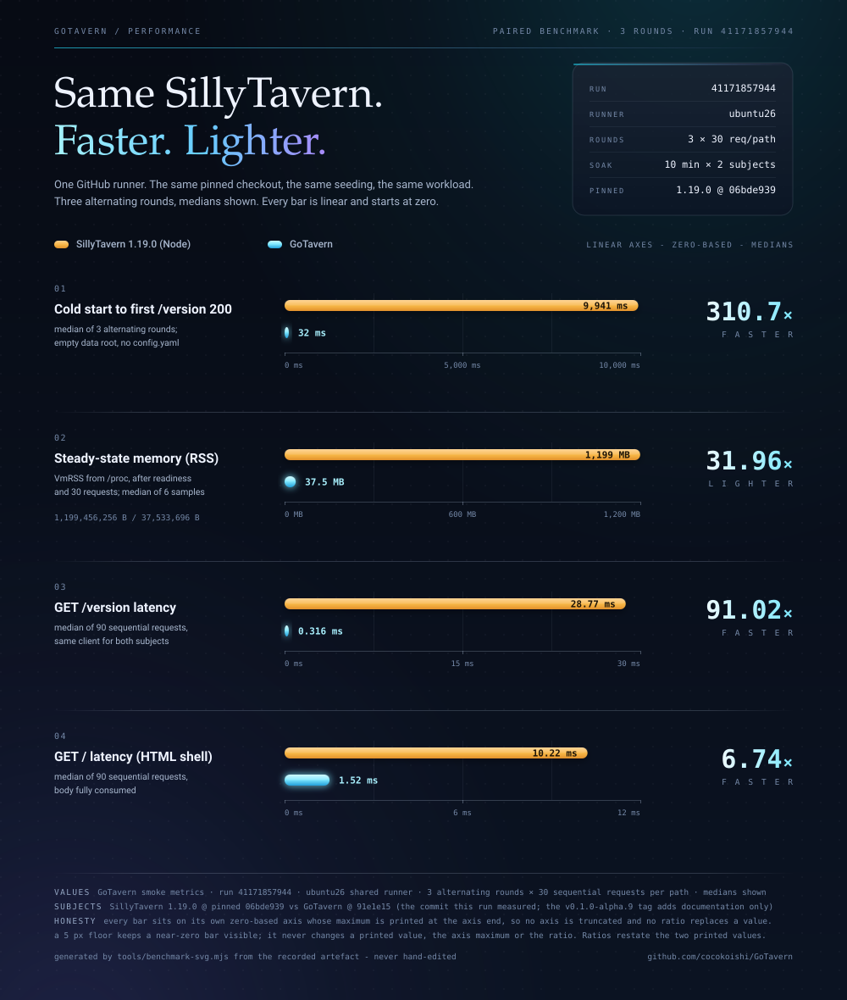

# GoTavern

[](https://github.com/cocokoishi/GoTavern/actions/workflows/ci.yml)
[](https://github.com/cocokoishi/GoTavern/releases)
[](LICENSE)

> **Status: `v0.1.0-alpha.8` plus an unreleased round — an ALPHA.** Keep a backup of a data directory you
> cannot restore.
>
> This README states only what a **fresh run on the current commit** shows. It does not inherit a status
> from an older round: the repository's history was rewritten on 2026-10-29 to normalise commit
> identities, which orphaned every commit object that earlier CI runs had judged, so the previous
> evidence chain could not be attached to this tree at all. Every claim below is now anchored to
> [`docs/goal-scorecard.md`](docs/goal-scorecard.md), which was re-derived against the rewritten lineage
> and cites runs whose `head_sha` is an ancestor of the current code.

## What it is

GoTavern is a **standalone Go reimplementation of the SillyTavern 1.19.0 server/backend**. It is not a
fork and not a new client: it serves the **unmodified upstream frontend** over the **same HTTP routes,
the same `config.yaml` semantics and the same on-disk data layout**, so your existing characters, chats,
groups, world info, presets, Quick Replies, settings, secrets, themes and frontend extensions keep
working with no conversion step and no private database.

Normal use needs **no Node.js, no npm and no compiler**: releases are prebuilt single binaries with the
frontend, the default content and the tokenizer manifest embedded. Node/npm appear only in development,
CI and reference builds.

The practical gain is operational, not cosmetic: in a paired benchmark on one GitHub runner (both
subjects from the same checkout, same seeding, same port allocator) GoTavern starts in seconds where
Node takes tens of seconds and holds a fraction of the steady memory. Those are one runner's numbers
with their provenance, not a general multiplier — see [Performance](#performance).

Baseline: `SillyTavern 1.19.0`, commit `06bde939fb1e9c4c8d8641d810f0a916b5bce127`. **Upstream is the
oracle**: every compatibility statement here is checked against a pinned Node SillyTavern, never
against memory, against a mock that defines its own correctness, or against a green badge.

## Download / Quick Start

Every path downloads a **prebuilt archive**; nothing is compiled on the target machine.

**[→ All releases](https://github.com/cocokoishi/GoTavern/releases)** — `v0.1.0-alpha.8` is the current
prerelease.

**Linux / macOS**

```sh
mkdir GoTavern
cd GoTavern

curl -fsSL https://raw.githubusercontent.com/cocokoishi/GoTavern/v0.1.0-alpha.8/install.sh | sh -s -- --version v0.1.0-alpha.8
```

> **Both installers install GoTavern directly into the current working directory** — on Linux and macOS as
> well as on Windows. Create the folder, `cd` into it, run the installer; that folder is where the files
> land. `--dir` / `-InstallDir` remain available as an **advanced override** for anyone laying several
> installs out deliberately.

**Windows (PowerShell)**

```powershell
mkdir GoTavern
cd GoTavern

irm https://raw.githubusercontent.com/cocokoishi/GoTavern/v0.1.0-alpha.8/install.ps1 -OutFile install.ps1
.\install.ps1 -Version v0.1.0-alpha.8
```

> **By default, the Windows installer installs GoTavern directly into the current working directory.**
> The directory you `cd` into is the directory GoTavern lands in — not `$HOME\GoTavern`, and not the folder
> the script was downloaded to. Create the folder, `cd` into it, run the installer.`-InstallDir` is an **advanced override** for anyone laying several installs out deliberately; the normal
invocation does not need it:

```powershell
.\install.ps1 -Version v0.1.0-alpha.8 -InstallDir "D:\Servers\GoTavern"
```

Re-running the installer inside an existing install **upgrades the program files in place** and leaves
`config.yaml`, `data\`, `extensions\` and `certs\` untouched: it never deletes or rebuilds the target
directory. `Start.cmd` resolves its own location, so the installed tree can be started from any shell:

```powershell
cd D:\Apps\GoTavern
.\Start.cmd
```

**An explicit `--version` / `-Version` IS REQUIRED WHILE THE NEWEST RELEASE IS A PRERELEASE.** Without
it the installers fetch `releases/latest/download/...`, which GitHub resolves to the newest **stable**
release — and there is none yet, so that URL 404s. That is deliberate: a prerelease must never be what
an unpinned `curl | bash` hands a stranger. Once a stable tag exists the flag becomes optional.

**Docker**

```bash
docker pull ghcr.io/cocokoishi/gotavern:v0.1.0-alpha.8
```

`:latest` deliberately lags — it only moves when a **stable** tag is published, so
`docker pull ...:latest` cannot silently upgrade a deployment onto an alpha.

**Manual**: download `gotavern-<os>-<arch>.tar.gz` (or `.zip` on Windows) from the release page, verify
it against `checksums.txt`, unpack it anywhere writable, and run `./start.sh` / `Start.cmd`.

**Updating** is the same archive unpacked over the old install. The binary, the launcher and
`src/tokenizers/` are immutable release files and are replaced; `config.yaml`, `data/`, `extensions/`
and `certs/` are never touched. Rolling back is the same operation with an older archive, and it is
exercised cross-baseline in CI.

**Requirements:** a 64-bit Linux, macOS or Windows host. No runtime dependencies. The frontend, the
default content and the tokenizer *manifest* are embedded in the binary; the tokenizer **data** ships
as `<install root>/src/tokenizers/` — the same path upstream SillyTavern keeps, because token counts
must be exact rather than approximated, and a missing tree would silently fall back to estimates while
still answering.

## Compatibility

### Read this first: three layers, three granularities

Status words mean different things at different layers, and mixing them is how a project ends up with a
README that says `proven`, a ledger that says `partial` and a matrix that says `FAIL` about one surface.
GoTavern keeps exactly **one machine truth per fact**:

| Layer | File | Granularity | What a word means there |
|---|---|---|---|
| User questions | [`docs/goal-scorecard.md`](docs/goal-scorecard.md) | 22 rows, one per question a user would ask | `proven` = a cited run on the current lineage, or a committed artefact, shows it; `partial`/`unproven` name what is missing |
| Capability matrix | [`docs/compatibility-matrix.md`](docs/compatibility-matrix.md) (generated from the JSON) | 22 capability areas | `PASS`/`PARTIAL`/`FAIL`/`NOT_APPLICABLE`, derived from evidence; a `PASS` row may not carry an evidence gap |
| Per-route ledgers | [`docs/api-inventory.md`](docs/api-inventory.md), [`docs/surface-coverage.md`](docs/surface-coverage.md), [`docs/compat-matrix.md`](docs/compat-matrix.md) | every route / provider / fixture | `compatible`/`partial`/`unsupported`/`not implemented`, per route, with the fixture that pins it |

A capability can be `proven` for the question it answers and `PARTIAL` as a capability area, and that is
not a contradiction: the question is narrower. Where the layers disagree about the SAME fact, one of
them is wrong — that is a defect, not a nuance.

### The user-facing answer

| Surface | State | Evidence (all on the current lineage) |
|---|---|---|
| A long-lived SillyTavern directory starts directly | **verified** | packaged archive over a stock tree (`GoTavern drop-in qualification` 40903954848, success); a synthesised long-lived tree asserted file-identical after boot (`tests/e2e/longlived_test.go`) |
| Existing data and extensions are not touched | **verified** | auto-update resolves OFF for every ambiguous input; the long-lived leg hashes the extension tree before and after boot |
| Character-list avatars, the opened card image, in-chat avatars, personas, thumbnails | **verified** | `Browser differential` 40925514681, `Compare the asset legs`: every image decoded on both subjects, no failed image request, no console load failure. `/thumbnail` serves real thumbnails at pinned paths and dimensions from a pure-Go codec; **byte equality with Jimp is not claimed** |
| Backgrounds display as in the original | **partially verified** | the gallery renders and stages tiles on both subjects, and 40 UI elements are reachable identically across four viewport sizes; the **paint/behaviour half is not measured** — the pinned frontend's own binding is absent on both subjects, so the differential is silent rather than negative |
| 酒馆助手 / JS-Slash-Runner boots, generates, mutates presets, injects, persists variables | **verified** | the same run's helper, helper-generation, helper-variable and REAL-preset legs: the iframe boots, the bridge reaches the host modules, `generateRaw` is byte-identical on both subjects, a variable's resolved value reaches the final request and survives a restart, and a preset mutated in `in_use` changes the next request identically |
| Every feature the extension offers | **partially verified** | what is proven is the list above. The extension's own breadth (its UI, its script editor, anything it implements purely in the iframe) is not covered, and "the extension works" is a bigger claim than "these interactions match pinned" |
| A real complex preset changes the model context exactly as pinned does | **verified** | `Node(A) == Go(A)`, `Node(B) == Go(B)`, and the presets differ from each other within one implementation — the three conditions that make a preset differential mean something |
| World-info activation, Author's Note depth, token truncation at the boundary | **verified** (truncation: at the measured boundary) | provider-wire replay for world info; the Q17 sweep for Author's Note; both subjects keep and drop the same turns in the same order. Truncation is **not** "proven in general": pinned's total message count is not monotone in `openai_max_context` |
| Streaming and cancellation | **partially verified** | request bytes and frame terminators across a real TCP middle, with a mid-stream cut releasing the same partial text on both subjects; a mid-stream **TLS** close is unobserved and no gate asserts the frame-ordering property itself |
| Reload, swipe, regenerate, continue | **verified** | `Browser differential` 40977195387 (success). Four verbs, each with its own comparator; the save/reload/swipe leg proves the two subjects were fed *different* bytes at a position neither compared request carries (in a separate sweep, run 40903953724, cancelled at its own timeout budget after that step had already passed), and the continue request is selected by the product's own nudge marker rather than by position |
| Handing a GoTavern-written tree back to pinned Node, and back again | **verified** | `Browser differential` 40977195387 (success): the external judge printed **hand-back verdict: match**, both directions judged with every count non-zero — GoTavern leg 5/5 and pinned leg 17/17 (continue requests 1, markers in the final chat 3, branches 1). One earlier CI execution of the same judge failed with `pinnedContinued` red (`answerPersisted: false` at a 60-second wait while the continue request HAD reached the provider) and passed on the next run, so that was a persistence-window flake in the pinned frontend rather than a product difference; the probe now records the page and chat-file tails at the moment a timeout fires. **Limit:** the fixture is a synthetic derivation, so its own chunk relations are unproven |
| CPU/RAM/startup versus Node | **verified** | `GoTavern smoke metrics` 40898332226, same runner and same checkout for both subjects — see [Performance](#performance) |

### Provider and route coverage

These numbers are **computed from the tree** by `tools/generate-doc-facts.mjs` on every CI run; they are
not typed by hand, and a disagreement fails the build.

| Area | State |
|---|---|
| Chat-completion providers | Every implemented pinned source except COMETAPI carries recorded provider-wire captures (pinned itself refuses COMETAPI before any request). <!-- BEGIN GENERATED: provider-wire.summary -->`25` sources with recorded provider-wire captures; `222` recorded scenarios.<!-- END GENERATED: provider-wire.summary --> |
| Provider wire | Every claimed source is compared against captures: request target, method, header set, body bytes (SHA-256), chunked framing, client-disconnect. A control test fails if a source is claimed without a capture. |
| Browser legs | **<!-- BEGIN GENERATED: browser.sources -->`15`<!-- END GENERATED: browser.sources --> sources** carry both a generation and a streaming comparison artefact, printed and enforced by `tools/verify-browser-comparisons.mjs`. |
| Startup | Differential over <!-- BEGIN GENERATED: startup.requests -->`353`<!-- END GENERATED: startup.requests --> requests; characters, chats, groups, world info, settings and secrets have replay fixtures. |
| Release path | Fresh install, idempotent re-install, tampered-archive refusal, update **and cross-baseline rollback** run in CI against the real `install.sh` / `install.ps1`, alongside the Windows-only installer behaviours. |

### Explicit boundaries

**Read this before you migrate.** These are decisions, not gaps waiting to close. Each is
`not implemented` for a stated reason and is never absorbed into a `partial` row. The full reasons,
with the pinned source and what a user sees, are in [`docs/config-inventory.md`](docs/config-inventory.md)
and `AGENTS.md`'s boundary list.

- **Arbitrary Node.js server plugins** — the one explicit ecosystem exclusion. Not emulated, not faked.
- **Local in-process ML** (`/api/extra/{caption,classify}`, `/api/speech/*`, local embeddings) — it would
  mean adopting an ONNX runtime, which contradicts the single-binary, `CGO_ENABLED=0` distribution.
  Captioning, classification and speech through SillyTavern's built-in local models will not work here.
- **Remote provider embeddings** — every remote embedding source answers an unimplemented status rather
  than returning an empty vector. The routes exist and local/body-supplied vectors work.
- **Image re-encoding that claims Jimp byte equality** — `/thumbnail` serves the observable contract
  (real images at pinned dimensions); `/api/avatars/upload` keeps the bounded pixel path.
- **Wire formats that live inside third-party npm packages** (Google voice `batchexecute`,
  `/api/translate/{google,bing}`) — owning an undocumented protocol is a product decision, not an accident.
- **`git.backend: builtin`** — pinned's builtin backend means isomorphic-git semantics; a pure-Go
  equivalent is a large dependency with its own behavioural divergence, so the configured value is
  accepted and the system-git path is used, with a causal error when git is absent.
- **Per-chat backups** (`backups.chat.*`) — pinned's throttled per-chat snapshot/prune subsystem is not
  reproduced; chat writes are atomic and whole-file, so a corrupt write is not the risk, but there is no
  per-chat restore safety net.
- **VERTEXAI service-account ("full") mode** — answers the pinned error shape rather than fabricating a
  credential.
- **Inherited upstream weaknesses are reproduced and recorded, not silently fixed** — content-import
  host matching uses the same substring test pinned uses, so `chub.ai.attacker.example` is treated as
  chub. A "safer but different" backend would break parity as badly as a worse one.

## Performance



| Metric | Pinned Node SillyTavern | GoTavern | Basis |
|---|---|---|---|
| Cold start to first `/version` 200 | 8,777 ms | **32 ms** | median of 3 rounds, a fresh `mkdtemp` data root per round, no `config.yaml` |
| Steady-state RSS (`VmRSS` from `/proc`) | 1,117 MiB | **36 MiB** | median of 6 samples, after readiness and after 30 requests per round |
| `GET /version` latency | 51.54 ms | **0.247 ms** | median of 90 sequential requests, same client both subjects (p95: 55.26 / 0.450) |
| `GET /` latency (HTML shell, body consumed) | 8.46 ms | **1.29 ms** | median of 90 sequential requests |

**Provenance, and what these numbers are not.** They are the summary of the `q22-paired-benchmark.json`
record produced by **`GoTavern smoke metrics` run `40898332226` (success)** on runner `ubuntu26`: three
rounds, 30 sequential requests per measured path, both subjects booted from the same pinned checkout with
the same seeding and the same port allocator, each round over a data root it deletes afterwards. They are
a **same-machine comparison** on a shared GitHub runner — not a benchmark you should expect on your own
hardware, and not a cross-machine product comparison. The ratios drawn in the figure are a restatement of
the two values in each panel, not a separate measurement. Reproduce them with the workflow — and note that
a fast server which assembles a different prompt would be a defect, which is why the compatibility gates
run on the same commit.

### In-process baseline, and one profile-driven fix

The paired benchmark answers "is it cheaper to run than Node". It cannot answer "which function
allocates, and did a change make it worse". `internal/server/bench_test.go` is that vehicle: it builds a
handler exactly as the tests do, completes the product's own CSRF and login handshake rather than
bypassing middleware, and measures a tiny route, the HTML shell, a static asset, the settings
aggregation and the character list.

The first profile found a real one. Serving `/script.js` — **497,669 bytes** — allocated **1,010,107
B/op**, and `pprof -alloc_space` put 66% of it in a single leaf: `embed.FS.ReadFile`, once per request. A
page load requests roughly 229 assets, so the server was copying every asset into the heap on every
request, for bytes that never change. Static serving now resolves the content **lazily** and streams the
slice the response already declared, with a re-read fallback so a failure cannot produce a short body
under a declared `Content-Length`.

| Benchmark | Before `ns/op` | After `ns/op` | Before `B/op` | After `B/op` | Change in `B/op` |
|---|---:|---:|---:|---:|---:|
| `GET /script.js` (497,669 B asset) | 478,654 | **170,644** | 1,010,107 | **43,347** | **−95.7%** |
| `GET /` (HTML shell) | 662,703 | **408,641** | 773,647 | **68,060** | **−91.2%** |
| five assets (one page load's worth) | 2,339,272 | **1,791,303** | 1,909,012 | **219,880** | **−88.5%** |
| `GET /version` (control, no asset) | 315,372 | 310,424 | 25,145 | 25,145 | 0% |

**Provenance.** These are **local, single-machine** numbers from this project's development host
(Windows/arm64, Go 1.27), produced with
`go test ./internal/server/ -run '^$' -bench Benchmark -benchmem -benchtime 300x`, before and after the
change on the same machine in the same session. They are an engineering baseline, not a product
comparison. The `GET /version` row is the control — it serves no asset and did not move, which is what
says the change was confined to static serving. The allocation reduction is confirmed causally:
`embed.FS.ReadFile` was 66% of `alloc_space` before and does not appear in the profile afterwards.

## How compatibility is decided

Compatibility is not "it opens and chats". Every claim is checked against a **pinned Node SillyTavern**
on five observation surfaces: browser→server HTTP, server→provider request bytes (target, method,
headers, body SHA-256), provider stream→browser, filesystem/startup side effects, and browser final
state. A behaviour verified only against our own mock is `unverified`, whatever the fixture says.

Four rules do the work, and each exists because its inverse has already produced a green that proved
nothing:

1. **Upstream is the oracle.** A difference is answered in a fixed order: pinned capture → is the probe
   faithful → is the fixture discriminating → does the gate have teeth → only then is the Go code a
   suspect. Never start at the last step.
2. **A citation must be ancestry-checked.** A run proves something about the commit it judged and no
   other. `internal/fixtures/documents_test.go` refuses a ledger citation whose `head_sha` is not an
   ancestor of the commit the ledger describes, and it refuses a run id that is not in
   `tests/docs/run-manifest.json` with its workflow and conclusion.
3. **A gate has teeth or it is decoration.** Every comparator has a self-test that mutates the thing it
   guards and requires the named assertion to go red. `tools/verify-browser-comparisons.mjs` refuses an
   artefact whose required guards are false, missing or contradicted by its own `unproven` list.
4. **Tests are derived from the oracle's own lists.** Every `router.use(...)` mount, every mounted
   endpoint router and every URL a pinned frontend module builds is an inventory row, and a test diffs
   that inventory against the Go registrations — because per-route discovery is how three mounts stayed
   missing through months of green runs.

Where a surface cannot be observed, the row says so instead of going green by omission — that is what
the `partial` and `unproven` rows are.

## Development

`docs/development-loop.md` lists the tiers and the measurements. The host can build, run the whole Go
suite and drive the browser differential end to end, so a failure can usually be reproduced locally
before a CI run is spent. `AGENTS.md`'s "Working mode" carries those measurements and the host artefacts
to exclude first — a `gofmt -l` that flags the whole tree because `core.autocrlf=true` checks it out as
CRLF, and a Windows-only environment-variable case difference.

```bash
node scripts/dev-verify.mjs          # ~7 s: gofmt + build + the tests your change can break
node scripts/dev-verify.mjs --full   # ~2 min: the whole Go suite, including every fixture replay
```

CI keeps the expensive gates: the full Go suite, `go vet`, the cross-compiles, the browser comparison
gate, the packaged-artifact drop-in qualification, and the Linux oracle that re-records every fixture
and requires a zero diff.

## License

GoTavern is released under **AGPL-3.0**, consistent with its use of the SillyTavern frontend. The root
`LICENSE` is copied from the pinned SillyTavern source, and `THIRD_PARTY_NOTICES.txt` ships in every
release archive.
