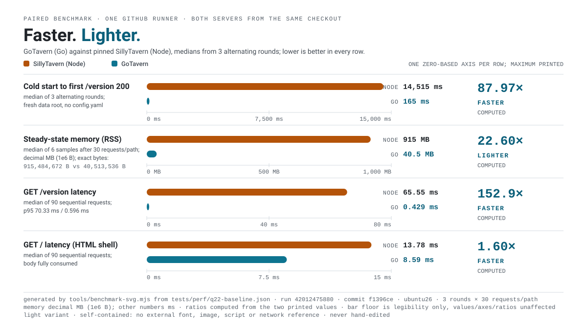

# GoTavern

**SillyTavern 1.19.0's server, rewritten in Go: one prebuilt binary, no Node.js at runtime, the unmodified upstream frontend, and your existing `config.yaml` and `data/` used in place.**

## Install

### 1. Drop it into the SillyTavern you already run (fastest)

Stop the Node server, download the archive for your platform from the [releases page](https://github.com/cocokoishi/GoTavern/releases), and copy **two pieces** into your existing SillyTavern folder: the binary, and the archive's `src/tokenizers/` data. A stock SillyTavern tree ships 9 of the 23 tokenizer files this server needs, so a binary-only copy would silently answer empty token counts for the rest.

```sh
# Linux / macOS: extract to a temporary folder, then copy the two pieces in
mkdir -p /tmp/gotavern-beta1 && tar -xzf gotavern-linux-amd64.tar.gz -C /tmp/gotavern-beta1
cp /tmp/gotavern-beta1/gotavern            /path/to/SillyTavern/
cp -r /tmp/gotavern-beta1/src/tokenizers/. /path/to/SillyTavern/src/tokenizers/
cd /path/to/SillyTavern && ./gotavern
```

```powershell
# Windows (PowerShell): same two pieces
Expand-Archive gotavern-windows-amd64.zip -DestinationPath $env:TEMP\gotavern-beta1 -Force
Copy-Item $env:TEMP\gotavern-beta1\gotavern.exe     <your-sillytavern-folder>\
Copy-Item $env:TEMP\gotavern-beta1\src\tokenizers\* <your-sillytavern-folder>\src\tokenizers\ -Recurse -Force
cd <your-sillytavern-folder>; .\gotavern.exe
```

That is the whole install: no config edit, no data conversion, and no Node.js, npm or Go on the machine. The binary embeds the pinned frontend and `default/`, reads `config.yaml` and `data/` from the folder it sits in, and uses your cards, chats, world info, presets and third-party extensions in place. The first start **adds** the scaffold the pinned server would create (default profiles, themes, presets, user data) and neither modifies nor deletes existing files; `config.yaml` is read, not rewritten. Run `./gotavern assets verify` (Windows: `.\gotavern.exe assets verify`) after copying: it must report the tokenizers path it verified and refuses a tree that is missing them.

The stock config opens a browser tab on start; add `--browserLaunchEnabled false` to suppress it. The Windows recipe above was executed end-to-end against a stock `1.19.0` tree for this release; the Linux/macOS recipe copies the same two archive members and is layout-verified by the release gates, not executed here (record: [`docs/beta1/install-verification.md`](docs/beta1/install-verification.md)).

### 2. Installer script into a fresh folder

```sh
mkdir GoTavern && cd GoTavern
curl -fsSL https://raw.githubusercontent.com/cocokoishi/GoTavern/main/install.sh | sh -s -- --version v0.1.0-beta.1
./start.sh
```

```powershell
mkdir GoTavern; cd GoTavern
irm https://raw.githubusercontent.com/cocokoishi/GoTavern/main/install.ps1 -OutFile install.ps1
.\install.ps1 -Version v0.1.0-beta.1
.\Start.cmd
```

Both installers download the prebuilt archive and verify `checksums.txt`; nothing compiles. Omit `--version` (Linux/macOS) or `-Version` (Windows) to install the newest stable release instead: `releases/latest` never serves a prerelease.

### 3. Docker

```sh
docker pull ghcr.io/cocokoishi/gotavern:v0.1.0-beta.1
```

`:latest` stays on the newest stable release; a prerelease publishes only its own tag.

### 4. Existing data, explicit copy

`gotavern migrate` copies a SillyTavern installation without writing to the source. Symlinks are refused rather than followed, and a destination holding runtime state is refused unless `--force` backs it up first. Platform matrix, update, rollback and preflight refusals: [`docs/INSTALLATION.md`](docs/INSTALLATION.md).

> Compatibility scope: GoTavern is qualified against pinned SillyTavern on synthetic corpora and recorded Node captures. The strong [`GOAL.md` §14](GOAL.md) bar — a real, long-used user directory — is **not met** yet, so back up data you cannot lose before pointing GoTavern at it.

## What it is

- **Same data, no conversion layer.** GoTavern reads and writes SillyTavern's own files; unknown fields and unknown files are preserved, and there is no private database or schema.
- **Drop-in frontend.** Pinned `public/**` is served byte-identically; the browser is the unmodified upstream SillyTavern UI.
- **Judged against upstream, not a mock.** Behaviour is compared with pinned SillyTavern `1.19.0` (`06bde939`) on five observer surfaces: browser, HTTP, provider wire, disk state and lifecycle.

## Release status

**`v0.1.0-beta.1` is the release this tree ships.** It is a **prerelease**: the [releases page](https://github.com/cocokoishi/GoTavern/releases/latest) still serves the newest stable release to unpinned installs, and `:latest` images and `releases/latest` do not move for a Beta. Install it by version (above) or download its assets directly. Notes: [`docs/release-notes-v0.1.0-beta.1.md`](docs/release-notes-v0.1.0-beta.1.md). Earlier releases stay downloadable by version, and updating or rolling back is the same operation with a newer or older archive: `config.yaml`, `data/`, `extensions/` and `certs/` are never replaced.

[](https://github.com/cocokoishi/GoTavern/actions/workflows/ci.yml)
[](https://github.com/cocokoishi/GoTavern/releases)

## Performance

<picture>
  <source media="(prefers-color-scheme: dark)" srcset="docs/assets/benchmark.svg">
  
</picture>

| Metric | Pinned Node SillyTavern | GoTavern | How it was measured |
|---|---|---|---|
| Cold start to first `/version` 200 | 14,515 ms | **165 ms** | median of 3 alternating rounds; fresh data root each round, no `config.yaml` |
| Steady-state RSS (`VmRSS` from `/proc`) | 915 MB | **40.5 MB** | median of 6 samples after readiness and 30 requests per path (60 per round) |
| `GET /version` latency | 65.55 ms | **0.429 ms** | median of 90 sequential requests (p95: 70.33 / 0.596) |
| `GET /` latency (HTML shell) | 13.78 ms | **8.59 ms** | median of 90 sequential requests; GoTavern's number includes gzip CPU |

Memory is decimal MB (1 MB = 1,000,000 bytes); every other number is milliseconds. One committed artifact, [`tests/perf/q22-baseline.json`](tests/perf/q22-baseline.json), is the source of this table and both figure variants; [`tools/check-perf-docs.mjs`](tools/check-perf-docs.mjs) recomputes every value in CI. The record is `GoTavern smoke metrics` run `42012475880` (success) at commit `f1396ce`: one shared runner, both servers booted from the same pinned checkout. Read it as a same-machine comparison, not a promise.

- **Regressions are shown, not hidden.** `/` carries gzip CPU because the HTML shell is compressed, and this release does not claim an improvement in these four headline metrics: every delta from the previous record is 1-6%, inside this harness's run-to-run variation.
- A ten-minute soak per subject recorded GoTavern RSS drift `-0.1 MB` and p95 `+0.35 ms` (pinned: `-571.3 MB` RSS, `-3.29 ms` p95). Method, the shipped optimization's on/off arms with the cost beside the gain, and every UNPROVEN row are in [`docs/performance.md`](docs/performance.md).

## Evidence

Recorded against the pinned Node server and replayed in CI: <!-- BEGIN GENERATED: provider-wire.summary -->`25` sources with recorded provider-wire captures; `262` recorded scenarios.<!-- END GENERATED: provider-wire.summary --> · <!-- BEGIN GENERATED: browser.sources -->`15`<!-- END GENERATED: browser.sources --> source pairs with generation and streaming browser comparisons · <!-- BEGIN GENERATED: startup.requests -->`353`<!-- END GENERATED: startup.requests --> startup requests compared at boot. Per-route ledgers: [`docs/compat-matrix.md`](docs/compat-matrix.md), [`docs/surface-coverage.md`](docs/surface-coverage.md), [`docs/goal-scorecard.md`](docs/goal-scorecard.md).

## Documentation

- [`docs/INSTALLATION.md`](docs/INSTALLATION.md): install, update, rollback, migration, platform matrix and acceptance evidence.
- [`docs/performance.md`](docs/performance.md): the paired benchmark, the recorded method and every unproven row.
- [`docs/SEMANTIC-COMPATIBILITY.md`](docs/SEMANTIC-COMPATIBILITY.md): the five observer surfaces and the pass standard.
- [`docs/goal-scorecard.md`](docs/goal-scorecard.md): 22 user questions, each with a state and an artefact.
- [`docs/development-loop.md`](docs/development-loop.md): test tiers, and what only the oracle can decide.

## License

**AGPL-3.0**, consistent with the SillyTavern frontend it serves. The root [`LICENSE`](LICENSE) is copied from the pinned SillyTavern source, and every release archive ships `THIRD_PARTY_NOTICES.txt`.
