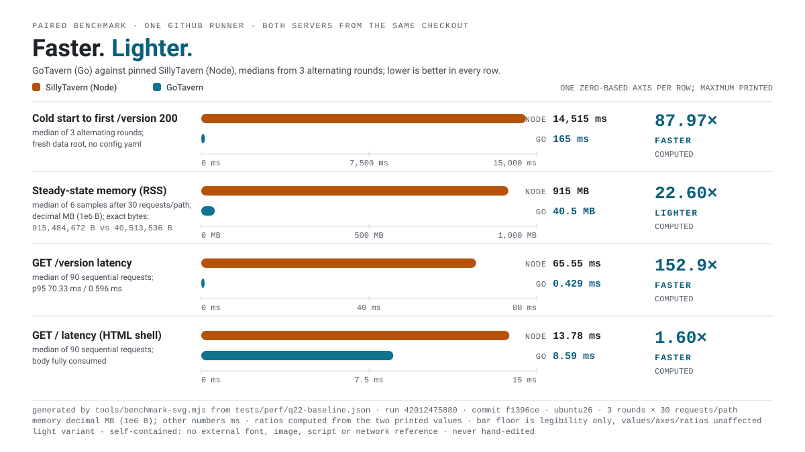

# GoTavern

**SillyTavern 1.19.0's server, rewritten in Go: one prebuilt binary, no Node.js on the host, the unmodified upstream frontend and the same `data/` layout.**

<picture>
  <source media="(prefers-color-scheme: dark)" srcset="docs/assets/benchmark.svg">
  
</picture>

Same runner, same checkout, medians of 3 alternating rounds; every number above is recomputed from one recorded artifact ([method and caveats](docs/performance.md)). Continue to [Performance](#performance) · [Compatibility](#compatibility) · [Install](#install).

## Three things to know

- **Light and fast.** 165 ms cold start against 14,515 ms, and 40.5 MB resident against 915 MB: one binary, no Node.js, no npm, no compiler on the host. The paired method and every unproven row are in [Performance](#performance).
- **Your existing tree, unchanged.** GoTavern reads and writes SillyTavern's own `config.yaml`, `data/`, cards, chats, world books, presets and extensions. There is no conversion layer and no private database; unknown fields and unknown files are preserved.
- **Judged against upstream, not a mock.** Behaviour is checked against pinned SillyTavern `1.19.0` (`06bde939`) on five observer surfaces: browser, HTTP, provider wire, disk state and lifecycle. "It opens and chats" is not accepted as evidence.

## Start in 30 seconds

**Linux / macOS**

```sh
mkdir GoTavern && cd GoTavern
curl -fsSL https://raw.githubusercontent.com/cocokoishi/GoTavern/main/install.sh | sh
./start.sh
```

**Windows (PowerShell 5.1+)**

```powershell
mkdir GoTavern; cd GoTavern
irm https://raw.githubusercontent.com/cocokoishi/GoTavern/main/install.ps1 -OutFile install.ps1
.\install.ps1
.\Start.cmd
```

Both installers download a **prebuilt archive** into the current directory; nothing compiles on your machine. Docker, manual downloads, updates, rollback and migration are in [Install](#install).

## Compatibility

The strong drop-in bar in [`GOAL.md` §14](GOAL.md) is **NOT MET**: the strongest executed evidence is a **synthetic** adversarial qualification (an audit, a deterministic scenario factory and real-browser differentials over a generated long-lived tree). No real, long-used user directory has been qualified; that channel's disposition is `PRIVATE_NOT_RUN`.

| Limit | State, dated 2026-11-09 |
|---|---|
| Real long-used directory (`GOAL.md` §14) | **NOT MET** — private channel `PRIVATE_NOT_RUN` |
| macOS ARM64 runtime | **UNVERIFIED** — archive built and inspected, not executed |
| `windows/arm64` | **BUILD-ONLY** — no hosted runner of that architecture |
| 8-user concurrent-write latency | **REPORT-ONLY** — no graded number claimed |
| Soak real-leak question | **UNPROVEN** — the GC-robust rule is a detection floor |
| Streaming-cancellation / relay p99 | **UNPROVEN** — no such metric exists yet |
| Page-init egress hermeticity | **OPEN** — some page initialisation still reaches the live network |

Machine truth per fact: [compatibility matrix](docs/compatibility-matrix.md) (generated) · [goal scorecard](docs/goal-scorecard.md) (22 user questions) · [performance](docs/performance.md) (method and unproven rows) · [installation](docs/INSTALLATION.md).

## Release status

**`v0.1.0-alpha.19` is the release this tree ships.** It is built and published by the release workflow from this tree's commit; the [releases page](https://github.com/cocokoishi/GoTavern/releases/latest) is authoritative for what is published right now. An unpinned install resolves `releases/latest`; pin a version for a reproducible deployment or a rollback target.

- One script, [`scripts/classify-version-tag.sh`](scripts/classify-version-tag.sh), decides channels for the release workflow, the Docker workflow and both installers: only a stable tag moves `:latest`.
- `v0.1.0-alpha.18` was the previous stable-channel release; earlier releases stay downloadable by explicit version. Back up any data directory you cannot afford to lose before upgrading.
- The [release notes](docs/release-notes-v0.1.0-alpha.19.md) carry the same limits; this README states them up front rather than below the fold.

[](https://github.com/cocokoishi/GoTavern/actions/workflows/ci.yml)
[](https://github.com/cocokoishi/GoTavern/releases)
[](LICENSE)

## Performance

| Metric | Pinned Node SillyTavern | GoTavern | How it was measured |
|---|---|---|---|
| Cold start to first `/version` 200 | 14,515 ms | **165 ms** | median of 3 alternating rounds; fresh data root each round, no `config.yaml` |
| Steady-state RSS (`VmRSS` from `/proc`) | 915 MB | **40.5 MB** | median of 6 samples after readiness and 30 requests per path (60 per round) |
| `GET /version` latency | 65.55 ms | **0.429 ms** | median of 90 sequential requests (p95: 70.33 / 0.596) |
| `GET /` latency (HTML shell) | 13.78 ms | **8.59 ms** | median of 90 sequential requests; GoTavern's number includes gzip CPU |

Memory is decimal MB (1 MB = 1,000,000 bytes); every other number is milliseconds. One committed artifact, [`tests/perf/q22-baseline.json`](tests/perf/q22-baseline.json), is the source of this table, both figure variants and the [provenance record](docs/assets/benchmark.svg.provenance.md); [`tools/check-perf-docs.mjs`](tools/check-perf-docs.mjs) recomputes every value in CI. The record is `GoTavern smoke metrics` run `42012475880` (success) at commit `f1396ce`: one shared runner, both servers booted from the same pinned checkout. Read it as a same-machine comparison, not a promise.

- **Regressions are shown, not hidden.** `/` carries gzip CPU because the HTML shell is compressed, and this release does not claim an improvement in these four headline metrics: every delta from the previous record is 1-6%, inside this harness's run-to-run variation.
- A ten-minute soak per subject recorded GoTavern RSS drift `-0.1 MB` and p95 `+0.35 ms` (pinned: `-571.3 MB` RSS, `-3.29 ms` p95). The methodology, the shipped optimization's on/off arms with the cost beside the gain, the resource analysis, the reproduction commands and the explicit UNPROVEN rows are in **[docs/performance.md](docs/performance.md)**.

## Install

Six canonical archives are published (linux and darwin amd64/arm64, Windows amd64/arm64), each with `checksums.txt` and `BUILD-INFO.txt`. Every published archive except `windows/arm64` is executed by release CI: linux/amd64 and windows/amd64 boot against a stock tree, linux/arm64 runs under QEMU, darwin/amd64 runs on a native macOS runner, and darwin/arm64 is built and inspected but not executed. Tokenizer data ships in `src/tokenizers/` so counts are exact, not estimated.

- **Docker:** `docker pull ghcr.io/cocokoishi/gotavern:latest` (linux/amd64). `:latest` moves only when a stable tag is published, never for a prerelease.
- **Manual:** download `gotavern-<os>-<arch>.tar.gz` (`.zip` on Windows) from the [releases page](https://github.com/cocokoishi/GoTavern/releases), verify it against `checksums.txt`, unpack anywhere writable, run `./start.sh` / `Start.cmd`.
- **Update / rollback:** re-run the installer or unpack a newer archive over the old install. The binary, launchers and `src/tokenizers/` are replaced; `config.yaml`, `data/`, `extensions/` and `certs/` are never touched. Rollback is the same operation with an older archive and is tested across baselines.
- **Migrate an existing SillyTavern:** point GoTavern at the existing directory, or run `gotavern migrate`. The source is strictly read-only during a copy migration, symlinks are refused rather than followed, and a destination holding runtime state is refused unless `--force` moves it to `.migrate-backup/` first. Auto-update resolves to OFF for every ambiguous input. GoTavern reads and writes SillyTavern's own files: unknown fields and unknown files are preserved, there is no conversion layer and no private database, and the do-not-rewrite boundaries in [`GOAL.md` §15.4](GOAL.md) stay intact.

Full platform matrix, installer behaviour, preflight refusals and acceptance evidence: **[docs/INSTALLATION.md](docs/INSTALLATION.md)**.

### Verify what you downloaded

```sh
sha256sum -c checksums.txt --ignore-missing   # macOS: shasum -a 256 -c checksums.txt
./gotavern version                            # GoTavern version and the pinned SillyTavern baseline
```

`BUILD-INFO.txt` in each archive records the version and the pinned upstream commit. The installers verify the checksum and refuse to continue if it does not match.

## What works, what is partial, what is not implemented

| Area | State |
|---|---|
| Pinned frontend, static assets, startup/config/data semantics | implemented and differentially gated |
| World info; streaming SSE framing, incremental render and cancellation | **PASS** in the capability matrix; every other capability row is `PARTIAL` with its gap named in the row, not implied |
| Chat-completion providers | <!-- BEGIN GENERATED: provider-wire.summary -->`25` sources with recorded provider-wire captures; `262` recorded scenarios.<!-- END GENERATED: provider-wire.summary --> |
| Browser differential legs | <!-- BEGIN GENERATED: browser.sources -->`15`<!-- END GENERATED: browser.sources --> source pairs carry both a generation and a streaming comparison artefact |
| Startup differential | over <!-- BEGIN GENERATED: startup.requests -->`353`<!-- END GENERATED: startup.requests --> recorded requests, with replay fixtures for characters, chats, groups, world info, settings and secrets |

**Not implemented, by recorded decision rather than omission:**

| Exclusion | Reason |
|---|---|
| Arbitrary Node.js server plugins | the one explicit ecosystem exclusion; never emulated |
| Local in-process ML (`/api/extra/{caption,classify}`, `/api/speech/*`, local embeddings) | would need an ONNX runtime and break the single-binary, `CGO_ENABLED=0` design |
| Remote provider embeddings | the routes exist and answer an unimplemented status rather than an empty vector |
| Jimp byte-equal image re-encoding | `/thumbnail` serves real images at pinned dimensions; byte equality is not claimed |
| Wire formats owned by third-party npm packages (Google voice `batchexecute`, `/api/translate/{google,bing}`) | owning an undocumented protocol is a product decision, not an accident |
| `git.backend: builtin` | the system-git path is used, with a clear error if git is absent |
| Per-chat backups (`backups.chat.*`) | implemented (alpha.18 scheduling/retention; alpha.20 `chat_metadata.integrity` guard and group-save schedule); see the disclosed differences below |
| VERTEXAI service-account ("full") mode | answers the pinned error shape instead of fabricating a credential |

Inherited upstream weaknesses are reproduced and recorded, not silently fixed: content-import host matching keeps upstream's substring test (`chub.ai.attacker.example` is treated as chub). Per-route ledgers live in [docs/compat-matrix.md](docs/compat-matrix.md) and [docs/surface-coverage.md](docs/surface-coverage.md).

**Disclosed differences, kept rather than hidden:** no Brotli decoder (single-binary design), so `/proxy` retries a safe request once without `br` and refuses a mutating one; pinned's derived `_cache/characters` disk cache is not implemented (rebuildable from the cards, so a performance/parity gap rather than data loss); thumbnail `dominantColor` can differ by ±1 in 7 of 24 recorded cases; pinned's `console.error` line for a failed backup is not reproduced. Reasons: [docs/SEMANTIC-COMPATIBILITY.md](docs/SEMANTIC-COMPATIBILITY.md) and the [alpha.20 charter](docs/alpha20/CHARTER.md).

## Development

Development and CI use Go 1.27+ and Node 24; production does not. Quick local loop:

```bash
node scripts/dev-verify.mjs          # ~7 s: gofmt + build + the tests your change can break
node scripts/dev-verify.mjs --full   # ~2 min: the whole Go suite, including every fixture replay
```

CI keeps the expensive gates: the full Go suite, `go vet`, `-race`, cross-compiles, the browser comparison, the packaged drop-in qualification and the Linux oracle re-record. A local green is not the CI gate; the Windows host artefacts to exclude first are in [docs/development-loop.md](docs/development-loop.md) and `AGENTS.md`.

## Documentation

- [docs/performance.md](docs/performance.md): the recorded paired benchmark, the shipped optimization and its cost, every unproven row.
- [docs/SEMANTIC-COMPATIBILITY.md](docs/SEMANTIC-COMPATIBILITY.md): the five observer surfaces and the pass standard.
- [docs/goal-scorecard.md](docs/goal-scorecard.md): 22 user questions, each with a state and an artefact.
- [docs/compatibility-matrix.md](docs/compatibility-matrix.md): the generated capability matrix.
- [docs/INSTALLATION.md](docs/INSTALLATION.md): install, update, rollback, migration and the platform matrix.
- [docs/development-loop.md](docs/development-loop.md): the test tiers, and what only the oracle can decide.

## License

**AGPL-3.0**, consistent with the SillyTavern frontend it serves. The root [`LICENSE`](LICENSE) is copied from the pinned SillyTavern source, and `THIRD_PARTY_NOTICES.txt` ships in every release archive.
